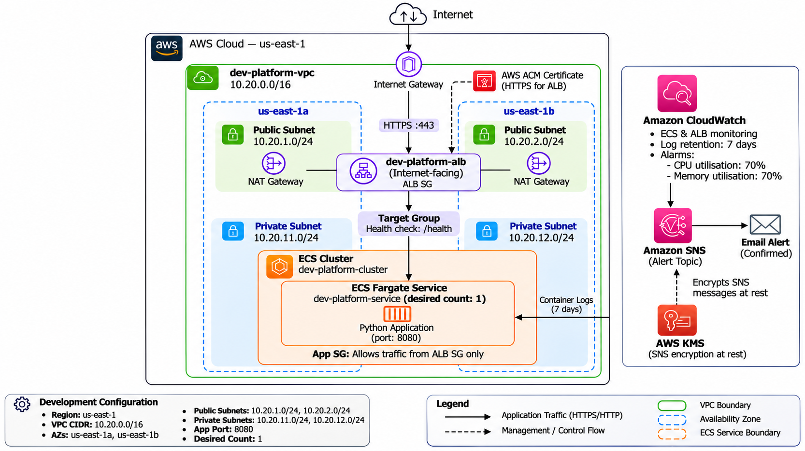
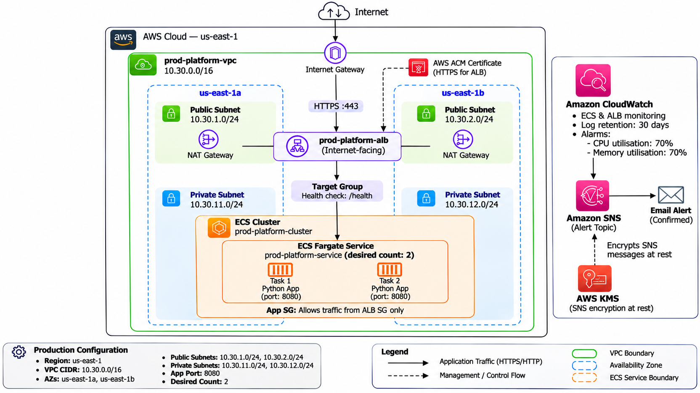
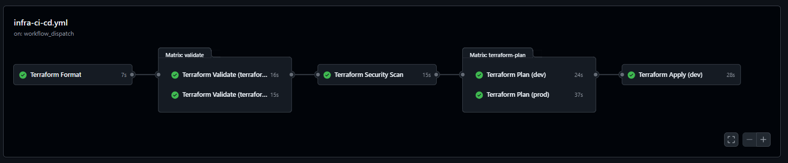
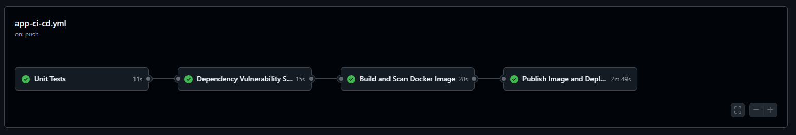
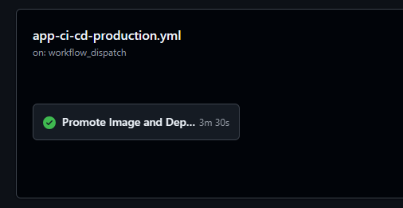

# AWS Multi-Environment Infrastructure and CI/CD

## Overview

This project demonstrates reusable, Terraform-managed AWS infrastructure for deploying a containerized Python application across development and production environments.

The platform uses Amazon ECS on AWS Fargate, Amazon ECR, an Application Load Balancer (ALB), Amazon VPC networking, CloudWatch monitoring, Amazon SNS notifications, AWS Key Management Service (KMS), and GitHub Actions for application delivery and infrastructure management.

The main objectives are to:

- Keep development and production infrastructure logically separated.
- Manage infrastructure as code with reusable Terraform modules.
- Validate infrastructure changes and scan configuration before planning.
- Authenticate GitHub Actions to AWS through OpenID Connect (OIDC), avoiding long-lived AWS access keys.
- Promote the same tested container image from development to production.
- Monitor application and infrastructure health.
- Make deployment, security, and operational trade-offs explicit.

## Architecture

### High-level architecture

The application runs as an ECS Fargate service in private subnets. An internet-facing ALB accepts incoming application traffic and forwards requests to healthy ECS tasks through a target group. Public and private subnets are distributed across Availability Zones. NAT Gateways provide outbound connectivity for private resources where configured and required.

GitHub Actions uses OIDC to obtain temporary AWS credentials for the relevant workflow role. Application images are stored in ECR. Terraform state is stored in an encrypted S3 backend with state locking, as configured by the backend setup.

### Development and production separation

Development and production are managed using separate Terraform environment roots and separate environment resources. Application deployment uses a development workflow, while production releases are handled by a separate manually triggered workflow.

Document concrete environment differences in this table after verifying the current Terraform configuration:

| Setting                       | Development                                           | Production                                       |
| ----------------------------- | ----------------------------------------------------- | ------------------------------------------------ |
| Terraform root                | `terraform/environments/dev`                          | `terraform/environments/prod`                    |
| ECS service                   | Dev environment service                               | Prod environment service                         |
| ECR repository                | Development repository                                | Production repository                            |
| Deployment trigger            | Eligible push to `main`, subject to workflow settings | Manual production release workflow               |
| Approval                      | As configured in GitHub                               | GitHub `prod` environment protection, if enabled |
| Log retention and task sizing | Verify in Terraform                                   | Verify in Terraform                              |

The environment architecture diagrams:

- [Development architecture](docs/architecture-dev.png)


- [Production architecture](docs/architecture-prod.png)


## Repository Structure

```text
## Repository Structure
AWS-Multi-Environment-Infrastructure/
├── .github/
│   └── workflows/
│       ├── app-ci-cd.yml
│       ├── app-ci-cd-production.yml
│       └── infra-ci-cd.yml
│
├── app/
│   ├── .dockerignore
│   ├── app.py
│   ├── Dockerfile
│   ├── ecs-task-definition.json
│   ├── requirements.txt
│   ├── requirements-dev.txt
│   └── test_app.py
│
├── bootstrap/
│   └── state-backend/
│       ├── backend.tf
│       ├── main.tf
│       ├── outputs.tf
│       ├── providers.tf
│       ├── variables.tf
│       ├── versions.tf
│       ├── .terraform.lock.hcl
│       └── terraform.tfvars
│
├── docs/
│   └── Architecture diagrams and supporting images
│
├── terraform/
│   ├── environments/
│   │   ├── dev/
│   │   │   ├── backend.tf
│   │   │   ├── main.tf
│   │   │   ├── outputs.tf
│   │   │   ├── providers.tf
│   │   │   ├── variables.tf
│   │   │   ├── versions.tf
│   │   │   ├── terraform.tfvars.example
│   │   │   └── .terraform.lock.hcl
│   │   │
│   │   └── prod/
│   │       ├── backend.tf
│   │       ├── main.tf
│   │       ├── outputs.tf
│   │       ├── providers.tf
│   │       ├── variables.tf
│   │       ├── versions.tf
│   │       ├── terraform.tfvars.example
│   │       └── .terraform.lock.hcl
│   │
│   └── modules/
│       ├── alb/
│       │   ├── main.tf
│       │   ├── variables.tf
│       │   └── outputs.tf
│       ├── ecr/
│       │   ├── main.tf
│       │   ├── variables.tf
│       │   └── outputs.tf
│       ├── ecs/
│       │   ├── main.tf
│       │   ├── variables.tf
│       │   └── outputs.tf
│       ├── iam/
│       │   ├── main.tf
│       │   ├── variables.tf
│       │   └── outputs.tf
│       ├── monitoring/
│       │   ├── main.tf
│       │   ├── variables.tf
│       │   └── outputs.tf
│       ├── network/
│       │   ├── main.tf
│       │   ├── variables.tf
│       │   └── outputs.tf
│       └── security-groups/
│           ├── main.tf
│           ├── variables.tf
│           └── outputs.tf
│
├── .gitignore
├── .trivyignore
├── README.md
└── Task 05 - Dilakshan.pdf
```


## Prerequisites

- Git
- Terraform `1.12.2` (matching the infrastructure workflow)
- AWS CLI
- Docker
- Python `3.12` for the CI test environment
- An AWS account with appropriately scoped IAM permissions
- A GitHub repository configured for AWS OIDC authentication
- The required Terraform variable files and backend configuration

The Terraform environments use AWS region `us-east-1`.

## Initial setup

### 1. Configure AWS authentication for GitHub Actions

Configure an AWS IAM OIDC identity provider for GitHub Actions and create role(s) with least-privilege permissions for the required workflows. Restrict the trust policy to the intended repository and branch or GitHub environment. Avoid storing long-lived AWS access keys in repository secrets.

The infrastructure workflow expects the GitHub Actions secret:

```text
AWS_TERRAFORM_ROLE_ARN
```


The application workflow may require its own role ARN secret and repository variables. Check the workflow files for the exact names and permissions used by each workflow.

### 2. Configure the Terraform backend

Configure the S3 backend and its state-locking mechanism according to the backend configuration in the repository. Bootstrap backend resources separately if the project does not create them through the normal environment roots.

Before using a new account, verify:

- The S3 bucket exists in the expected account and region.
- State encryption and access restrictions are enabled.
- State locking is configured for the Terraform version and backend implementation in use.
- IAM permissions allow the workflow to read and write the intended state.
- Development and production state keys are distinct.
- The backend is not accidentally destroyed when cleaning up application infrastructure.

Do not commit secrets or local state files. Treat Terraform state and saved plan artifacts as sensitive because they can contain infrastructure details and potentially sensitive values.

### 3. Configure GitHub repository settings

Review the workflows and configure the required secrets, variables, and GitHub environments. The development image publishing/deployment workflow expects the repository variable:

```text
ENABLE_ECR_PUSH=true
```

The production workflow requires a source image commit SHA and explicit confirmation, as implemented in the workflow. Configure protection and approval rules for the GitHub `prod` environment if production approval is required.

## Infrastructure management

Terraform configuration is maintained separately for development and production.

### Format and validate

Run from the repository root in PowerShell:

```powershell
terraform fmt -check -recursive terraform/

terraform -chdir=terraform/environments/dev init -backend=false -input=false
terraform -chdir=terraform/environments/dev validate

terraform -chdir=terraform/environments/prod init -backend=false -input=false
terraform -chdir=terraform/environments/prod validate

git diff --check
```

The `init -backend=false` commands initialise providers and modules without connecting to the remote backend. They are suitable for local validation, not for planning against deployed state.

### Review a plan

After configuring the backend, AWS credentials, and the appropriate variable file, generate and review a plan:

```powershell
terraform -chdir=terraform/environments/dev init
terraform -chdir=terraform/environments/dev plan -var-file=terraform.tfvars.example
```

Use the correct variable file for the selected environment. Do not assume `terraform.tfvars.example` is suitable for applying real infrastructure; example files may contain placeholder values.

Review additions, updates, replacements, deletions, security group changes, network changes, and costs before applying.

> **Safety:** A successful plan is not an approval to apply. Apply only a reviewed plan for the intended environment.

### Infrastructure CI workflow

The `Infrastructure CI` workflow:

1. Checks Terraform formatting.
2. Initialises and validates the dev and prod configurations.
3. Scans Terraform configuration using Trivy for HIGH and CRITICAL findings.
4. Generates separate dev and prod plans on eligible pushes to `main` and manual workflow runs.
5. Uploads the saved plan and readable plan output as short-lived artifacts.
6. Supports a manual apply for the selected environment using the corresponding saved plan.

The workflow uses GitHub Actions OIDC credentials rather than long-lived AWS access keys. Pull requests run formatting, validation, and security checks; the AWS-backed plan is restricted by the workflow's event and branch conditions.

Infrastructure apply operations are restricted to manual workflow dispatches on `main` when `operation` is set to `apply`. Production applies should use the configured GitHub `prod` environment protection rules. Confirm the target environment, review the plan, and ensure the saved plan belongs to the intended commit before applying.

The workflow scans Terraform configuration with the repository's `.trivyignore`. Exceptions should be narrow, documented, periodically reviewed, and removed when the underlying issue is fixed.


## Application CI/CD

### Continuous integration

The application CI workflow performs the checks configured in `.github/workflows/app-ci-cd.yml`, including:

- Installing Python dependencies and running unit tests.
- Auditing Python dependencies using `pip-audit`.
- Building the Docker image.
- Scanning the image using Trivy for HIGH and CRITICAL vulnerabilities.

The image build and scan depend on successful earlier checks as configured in the workflow.

### Development deployment

Publishing and deployment are restricted to eligible pushes to `main` and require the repository variable:

```text
ENABLE_ECR_PUSH=true
```

The development workflow:

1. Authenticates to AWS through GitHub OIDC.
2. Builds and pushes an image tagged with the Git commit SHA.
3. Renders and validates the ECS task definition.
4. Registers the task definition with ECS.
5. Updates the development ECS service.
6. Waits for ECS service stability.
7. Verifies the active task definition and running task counts.

Deployment concurrency is controlled to avoid automatically cancelling an active development deployment.


### Production release

Production deployment is handled by the separate manually triggered workflow.

The release process requires:

- A 40-character Git commit SHA identifying the source image in development ECR.
- Explicit confirmation of the production deployment.
- The configured GitHub `prod` environment and its approval requirements.

The workflow:

1. Validates the requested source image tag and retrieves its ECR digest.
2. Promotes the existing image from development ECR to production ECR without rebuilding it.
3. Verifies that source and destination image digests match.
4. Renders and registers the production ECS task definition.
5. Updates the production ECS service.
6. Waits for service stability and verifies the deployed task definition and running task counts.

Production releases are serialised through a dedicated concurrency group. Promoting the same image digest helps ensure that the artifact tested in development is the artifact released to production.

## Docker build strategy

The current Python application is small, so a straightforward single-stage Docker build is a reasonable choice for this assessment. A multi-stage build is not automatically required for every Python service; its value depends on whether the build needs compilers, development headers, or other dependencies that should not be present in the runtime image.

For a larger or more complex production application, consider a multi-stage build that separates dependency compilation from the runtime image. Regardless of build stage count, production hardening should consider:

- Using a small, supported base image and keeping it updated.
- Pinning dependencies and reviewing upgrades.
- Running as a non-root user.
- Excluding unnecessary files through `.dockerignore`.
- Avoiding secrets in image layers and build arguments.
- Scanning the image and addressing relevant vulnerabilities.
- Using immutable commit-SHA tags and verifying image digests.
- Keeping the runtime image limited to the files and packages the application needs.

**Current versus future:** Verify the actual `app/Dockerfile` before claiming that any specific hardening measure is already implemented. Multi-stage builds and other improvements below are recommendations, not statements that the current Dockerfile already provides them.

## Security

Current security controls include the following, as configured in the project:

- GitHub Actions authenticates to AWS using OIDC.
- IAM roles provide workflow-specific AWS permissions.
- Development and production use separate resources and ECR repositories.
- Terraform configuration is scanned for HIGH and CRITICAL findings.
- Python dependencies and container images are scanned for vulnerabilities.
- Container images use commit-SHA identifiers in the CI/CD process.
- Production image promotion includes digest verification.
- ECS tasks run on Fargate in private subnets.
- Terraform state is stored remotely in S3 with encryption and state locking.
- Production deployment requires explicit confirmation and environment approval.

### Documented Trivy exceptions

The `.trivyignore` file contains documented exceptions:

- `AVD-AWS-0053`: public ALB exposure is required for the application's external endpoint.
- `AVD-AWS-0104`: a temporary exception for ECS outbound connectivity required by the current design.

These exceptions represent trade-offs, not proof that the configurations are risk-free. Review them periodically. Where feasible, use VPC endpoints and restricted egress rules to reduce dependency on broad outbound access.

### SNS encryption and alerting

The monitoring module configures an SNS topic for alert notifications and a customer-managed KMS key when alarms are enabled. KMS keys have lifecycle and cost implications; ensure key policies permit the required SNS operations and follow the planned key-retention and deletion procedures.

An SNS subscription must be confirmed by its recipient before email notifications can be delivered. A confirmed subscription alone does not prove that a CloudWatch alarm will trigger or that a notification will arrive. Test the alert path when appropriate.

## Monitoring and logging

CloudWatch monitoring is configured for application and infrastructure health, including:

- ECS CPU and memory utilisation.
- Running ECS task counts.
- Application Load Balancer HTTP 5xx responses.
- Unhealthy target counts.
- ECS application logs.

CloudWatch dashboards and alarms are configured separately for development and production. ECS Container Insights is enabled, with environment-specific log retention as defined in Terraform.

After deployment, check ECS service events, running task counts, target group health, container logs, and CloudWatch alarm state. Confirm the SNS subscription and test notification delivery if alert verification is required.

## Verification and troubleshooting

### Application health

Use the health endpoint configured for the application and ALB. For example, if the environment exposes a public ALB DNS name:

```powershell
Invoke-WebRequest "https://<application-host>/health"
```

Replace `<application-host>` with the actual hostname and use HTTPS only when the hostname and TLS configuration support it. A successful response confirms that the endpoint responded; it does not alone prove every dependency is healthy.

### Useful checks

- **ECS tasks fail to start:** inspect ECS service events and stopped-task reasons.
- **ALB targets are unhealthy:** verify target group health checks, application port, security group rules, and the health endpoint.
- **Image pull fails:** verify ECR repository, image tag, task execution role permissions, and network access.
- **No alert email arrives:** check the CloudWatch alarm state, alarm actions, SNS topic, subscription confirmation, KMS permissions, and delivery status where available.
- **Terraform reports drift:** review the plan and identify manual changes before applying.
- **Terraform backend errors:** verify the backend bucket, state key, locking configuration, region, and IAM permissions.

Avoid pasting credentials, state contents, secret values, or sensitive plan output into issue trackers or public logs.

## Operational considerations

- Review Terraform plans before applying changes.
- Verify ECS health and CloudWatch alarms after deployments.
- Investigate failures through ECS service events and application logs.
- Keep IAM permissions scoped to the intended environment.
- Protect Terraform state and limit access to plan artifacts.
- Avoid manual changes to Terraform-managed resources unless the resulting drift is understood.
- Preserve the remote state backend when cleaning up environment resources.
- Confirm the intended account, region, and environment before destructive operations.

## Cost considerations

AWS resources can incur charges even when application traffic is low. Review current AWS pricing and available credits before provisioning or retaining resources.

Particular cost drivers include:

- NAT Gateways and processed data.
- Application Load Balancers.
- ECS Fargate CPU and memory allocation.
- ECR image storage and data transfer.
- CloudWatch log ingestion, retention, dashboards, and alarms.
- Customer-managed KMS keys.

For temporary assessment environments, define a cleanup procedure and review the Terraform destroy plan carefully before execution. Do not delete shared backend resources or state that is needed to manage other environments. A Terraform destroy operation can remove application infrastructure and interrupt service availability.

## Known limitations and future enhancements

The following are potential improvements to consider; they should not be interpreted as implemented unless the repository and deployed configuration confirm them.

### Security

- Replace broad ECS outbound access with VPC endpoints and narrowly scoped egress where practical.
- Review and reduce IAM permissions using least privilege.
- Harden and minimise the runtime container image.
- Review Trivy exceptions regularly and remove them when no longer needed.
- Define a documented process for patching base images and dependencies.

### Reliability and deployment safety

- Add automated post-deployment smoke tests for application endpoints.
- Document and test ECS rollback and recovery procedures.
- Review health-check behaviour, deployment circuit breakers, and service capacity.
- Test recovery from failed tasks and unhealthy targets.

### Observability

- Test CloudWatch alarm-to-SNS delivery end to end.
- Improve alert runbooks with severity, ownership, and response steps.
- Consider centralised dashboards and log correlation across environments.

### Infrastructure automation

- Add policy-as-code checks and clearer plan review controls.
- Consider automated Terraform drift detection.
- Keep workflow actions and tool versions updated through a controlled process.
- Improve reusable workflow and module documentation as the project grows.

### Cost and operations

- Evaluate NAT Gateway costs and endpoint alternatives.
- Add cost alerts or budgets.
- Document a repeatable assessment-environment cleanup procedure that preserves shared state.

## Current scope

This project demonstrates multi-environment Terraform configuration, automated infrastructure checks, application testing and security scanning, controlled container image promotion, ECS deployment verification, and CloudWatch monitoring.

Production deployment should be performed only through the intended release workflow after reviewing the source image, approval requirements, Terraform plan where applicable, and expected impact.

## Assessment evidence

For an assessment submission, useful evidence includes:

- A successful Infrastructure CI run showing formatting, validation, security scan, and plans for both environments.
- A successful development apply, if applying dev changes is part of the assessment.
- Successful application health-check output.
- Evidence that the SNS subscription is confirmed, if alerting is part of the demonstrated scope.
- Architecture diagrams that match the submitted Terraform configuration.

Remove or redact account IDs, email addresses, public endpoints, and other details if they should not be exposed in a public repository.
